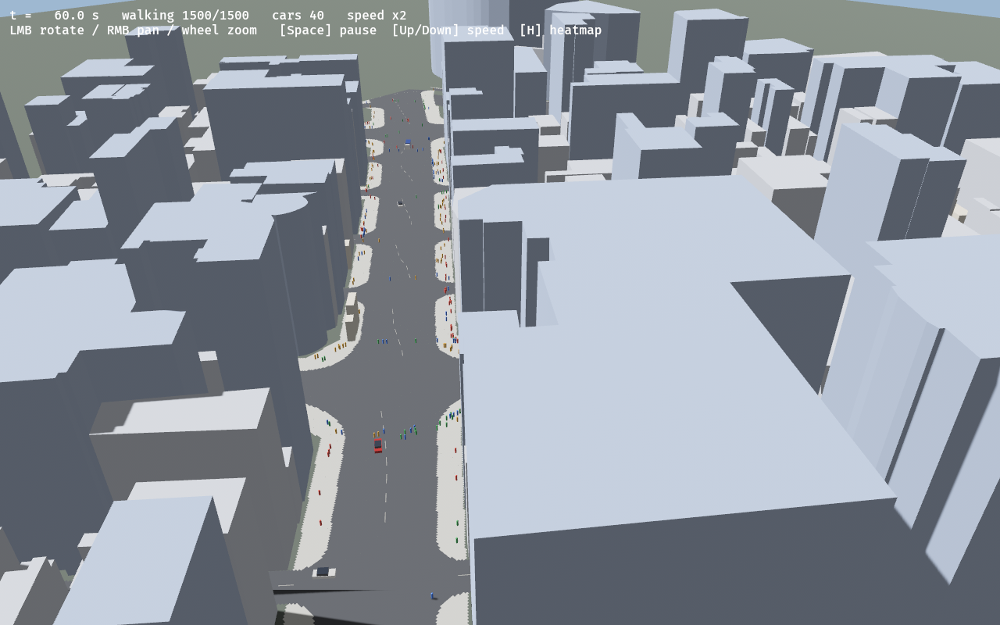
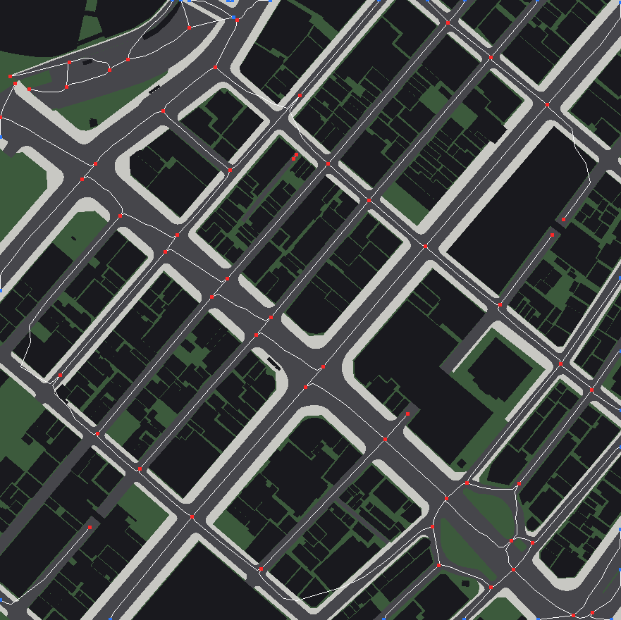
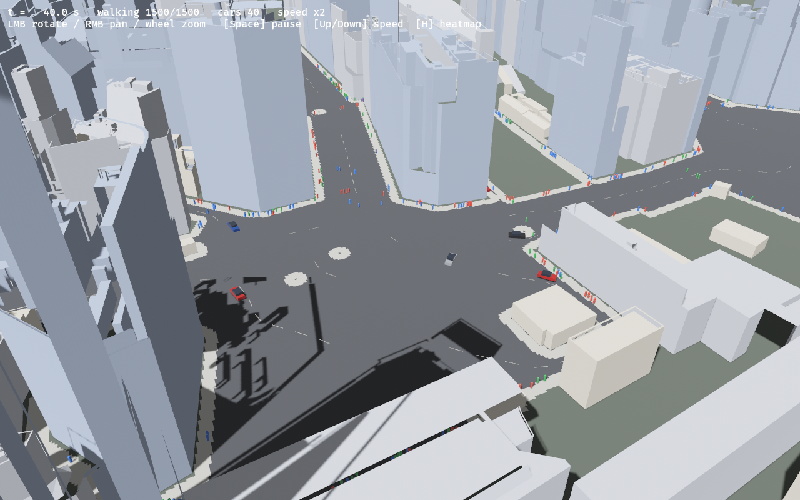
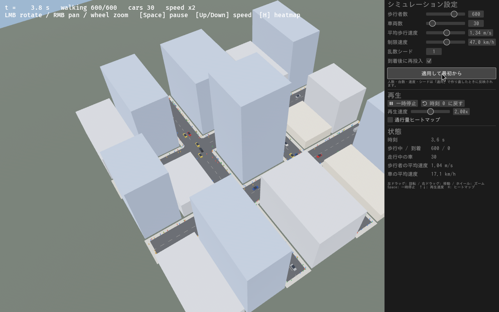
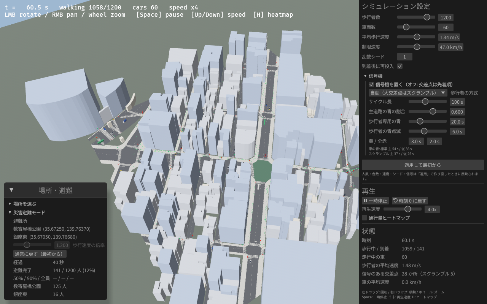
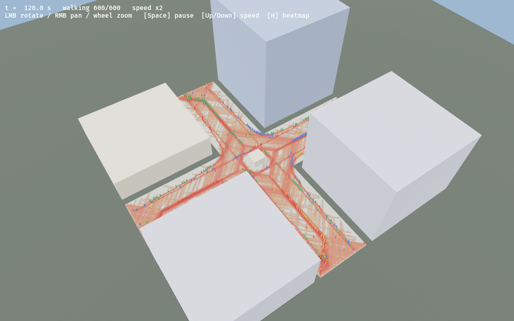
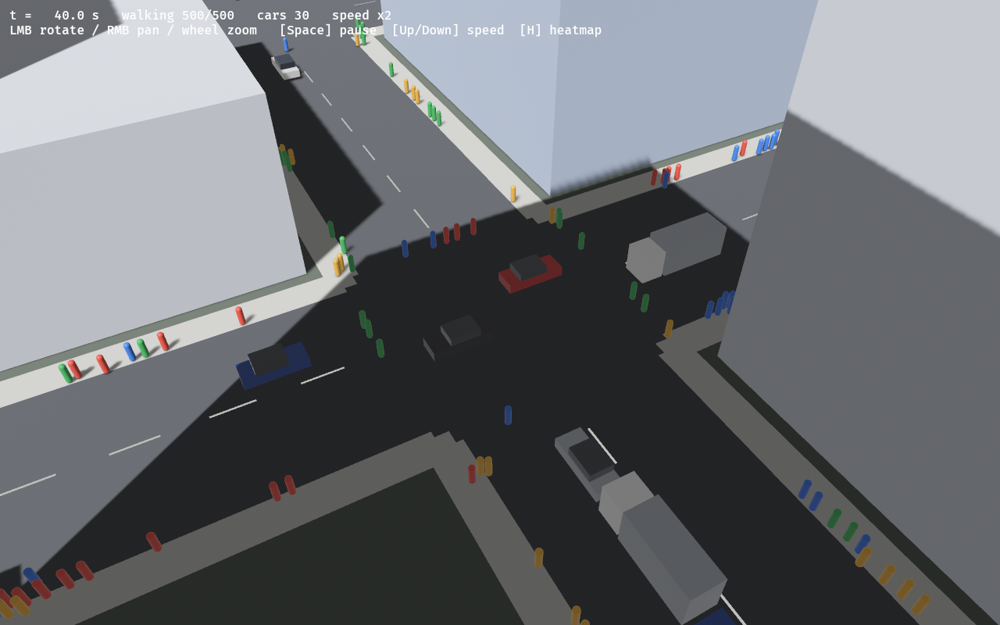

# plateau-crowd

Project PLATEAU（国交省 3D 都市モデル, CityGML）上で歩行者の流れをシミュレートする pure Rust アプリ。

## 構成

```
crates/
  plateau-gml/  CityGML (bldg / tran) のストリーミングパーサ（quick-xml）
  walkmap/      緯度経度→局所平面、歩行可能グリッド、フローフィールド、障害物距離場
  crowd/        Social Force Model による歩行者の計算、災害避難モード
  traffic/      車道の中心線ネットワーク抽出と車両の計算（IDM・左側通行・交差点制御・車種）
  fetch/        場所（住所 or 緯度経度）から PLATEAU の CityGML を探して取得（国土地理院ジオコーダ + PLATEAU 配信 API）
  cli/          ヘッドレス実行。軌跡 CSV と通行量ヒートマップ PNG を出力
  viewer/       bevy 0.16 による 3D ビューア（建物の押し出し表示 + 歩行者 + ヒートマップ）
scripts/        公式 CityGML の取得 (fetch-ginza.sh) と範囲切り出し (extract_gml.py)
testdata/
  sample.gml    合成テストデータ（東京駅付近 200m 四方、幅 20m の「井」の字の道路と 15 棟）
  ginza/        公式 PLATEAU CityGML から切り出した銀座 4 丁目交差点周辺（建物 457 棟、LOD3 道路 160 件）
```

処理の流れ:

1. **読込**: `bldg:Building` の LOD0 フットプリント（無ければ LOD1 立体の底面）と `tran:Road` の LOD1 路面を取得。座標は EPSG:6697（緯度・経度・楕円体高）。
2. **歩行空間**: 道路面があれば「道路 ∖ 建物」、無ければ「範囲 ∖ 建物」を 0.5m グリッドに塗る。LOD2/LOD3 の道路なら `tran:TrafficArea` の区分（1000 車道部・1020 島 → 車道、2000 歩道部・3000 自転車道 → 歩道、`AuxiliaryTrafficArea` の植栽・分離帯 → 通行不可）をそのまま使う。LOD1 だけの道路では道路の端から 3m を歩道、それより内側を車道とみなす近似を使う。名前に「高速」を含む路線（高架・掘割の首都高）は地上と交わらないので除く。
3. **経路誘導**: 目的地ごとに 8 近傍 Dijkstra で距離場（フローフィールド）を作る。壁際はコスト増。
4. **歩行者モデル**: 駆動力 + 他者反発（視野異方性つき）+ 壁反発 + 車からの反発 + 接触力。近傍探索は空間ハッシュ。車道の通行コストを 6 倍にして、歩道を歩き車道は短く横断するようにしている。
5. **車両モデル**:
   - 車道を Zhang–Suen 法で細線化して中心線を取り出し、交差点ノードと道路区間のグラフにする。範囲の縁で途切れる道路は出入口になる。
   - 左側通行で中心線から 1.8m ずらして走る。縦方向は Intelligent Driver Model（前の車・停止線・前方の歩行者に追従）。
   - 交差点は「動線（進入レーン→退出レーン）」単位の通行権で制御する。軌跡が交わらない動線（対向の直進同士など）は同時に通れ、待ち車がいれば 6 秒で交代。出口側が詰まっていれば交差点に入らない。
   - **信号機**（既定でオン、`--signals off` で上の先着順だけに戻せる）: 分岐ノードを交差点ごとにまとめ（広い交差点で割れた節点は 1 つに）、流入路を道路の向きで主道路・従道路の 2 現示に分ける。各流入路の口（車道幅が道路本来の幅に戻る所）に幅 4m の横断歩道と、その手前に停止線を置く。サイクルは 主道路 青→黄→全赤 → 従道路 青→黄→全赤（→ 歩行者専用現示）。車は赤と、無理なく止まれる黄で停止線に止まり、青の間だけ上の通行権で交差点に入る。
   - 歩行者信号の方式は `--signals` で選ぶ: `concurrent`（歩車同時: 並行する車が青の間に青、終わりは点滅）、`exclusive`（歩車分離: 歩行者専用現示で全横断歩道が青）、`scramble`（スクランブル: 歩行者専用現示で交差点内を斜めにも渡れる）、`auto`（既定: 両方向とも車道幅 14m 以上の 4 方向交差点だけスクランブル、他は歩車同時。銀座 4 丁目・数寄屋橋などが該当）。サイクル長・主道路の青の割合・歩行者専用の青は `--cycle` `--main-split` `--ped-green` か、ビューアの設定パネルで変えられる。
   - 歩行者は青でない横断歩道・交差点内へ歩道から踏み出さず、縁石で待つ（渡り始めた人は渡り切る）。信号があるときは横断歩道の通行コストを下げ、スクランブル以外の交差点内は高くして、横断歩道を渡るように経路を引き直す。
   - 歩行者が前にいれば止まり、5 秒以上にらみ合ったら徐行で進む。縁に着いた車は別の出入口から再投入する。
6. **出力**: `t,kind,id,lat,lon,x,y,vx,vy` の CSV（kind は `ped` / `car`）（kepler.gl / QGIS / deck.gl でそのまま可視化可）と PNG。

## 使い方

```sh
cargo run --release -- --gml testdata/sample.gml --agents 400 --vehicles 30 --duration 300 \
    --csv out.csv --png heatmap.png

# PLATEAU の 3 次メッシュ単位の GML を複数／ディレクトリで渡せる
cargo run --release -- --gml udx/bldg/53394611_bldg_6697_op.gml \
    --gml udx/tran/53394611_tran_6697_op.gml --agents 2000
```

## 実際の PLATEAU データで動かす

### 場所を指定して自動で取得する

`--place` に住所か「緯度,経度」を渡すと、範囲（`--radius`、既定 220m）にかかる 3 次メッシュの CityGML（建物・道路）を
`--data-dir`（既定 `data/plateau`）に用意して、その範囲を切り出して動かします。

```sh
cargo run --release -p plateau-crowd-viewer -- --place "東京都中央区銀座4丁目" --radius 220
cargo run --release -- --place 35.65949,139.70055 --radius 200 --agents 1500 --png shibuya-heat.png
```

1. 住所は国土地理院の住所検索 API（`msearch.gsi.go.jp`）で緯度経度にする
2. 中心と半径から 3 次メッシュ（約 1km 四方）のコードを求める
3. `--data-dir` 以下（4 階層まで）に `<メッシュ>_bldg_*.gml` / `<メッシュ>_tran_*.gml` があればそれを使う（オフラインでも動く。同梱の銀座なら `--data-dir testdata`）
4. 無ければ PLATEAU の CityGML 配信 API（`api.plateau.reearth.io/datacatalog/citygml/m:<メッシュ>`）でメッシュ単位の GML を探してダウンロードする。
   区境のメッシュは区ごとのファイルを両方取り、同じ自治体に複数年度あれば最新を使う

取得できないとき（ネットワークの制限など）は、[G空間情報センター](https://www.geospatial.jp/ckan/dataset/plateau) から
該当する市区町村の CityGML を落とし、`udx/bldg` と `udx/tran` の該当メッシュのファイルを `--data-dir` に置けば同じコマンドで動きます。
`--gml` と一緒に `--place` を渡すと、ダウンロードせずに手元のファイルからその場所を切り出します。

ビューアでは左下の「場所・避難」ウィンドウの「場所を選ぶ」で、住所か緯度経度と半径を入れて「この場所を読み込む」を押すと、
データを用意してから同じ設定のまま新しい場所で開き直します。

### まず試す: 銀座 4 丁目交差点（同梱の公式 CityGML 抜粋）

東京都 23 区（2023 年度）の CityGML から銀座 4 丁目交差点（和光・三越前）を中心とする半径 260m を切り出したものを `testdata/ginza/` に同梱しています。
LOD3 の道路（車道部・歩道部・島）が入っているので、中央通り・晴海通りの広い歩道と車道が実際の形で区別されます。

```sh
cargo run --release -p plateau-crowd-viewer -- --gml testdata/ginza/53394601_bldg_6697_op.gml \
    --gml testdata/ginza/53394601_tran_6697_op.gml --crop 35.67165,139.76500,220 --agents 1500 --vehicles 40

# ヘッドレスで CSV / ヒートマップ / 確認用地図
cargo run --release -- --gml testdata/ginza/53394601_bldg_6697_op.gml --gml testdata/ginza/53394601_tran_6697_op.gml \
    --crop 35.67165,139.76500,220 --agents 1000 --vehicles 30 --duration 300 --csv ginza.csv --png ginza-heat.png --map-png ginza-map.png
```





地図の明るい灰色が歩道部、暗い灰色が車道部（LOD3 の TrafficArea 由来）、白線が抽出した車道の中心線です。

メッシュ全体（銀座・有楽町・新橋・日比谷、建物 2297 棟・道路 1007 件、約 290MB）は `scripts/fetch-ginza.sh` で取得できます。
別の場所を切り出して小さな GML にするには `scripts/extract_gml.py 入力.gml 出力.gml 緯度 経度 半径m` を使います（建物は LOD0/LOD1 だけ、道路は区分面を残し、LOD3 の三角形メッシュは shapely があれば平面ポリゴンにまとめます）。

出典: 国土交通省 Project PLATEAU 3D 都市モデル（東京都 23 区、2023 年度）を加工して作成（[PLATEAU サイトポリシー](https://www.mlit.go.jp/plateau/site-policy/)、CC BY 4.0 互換）。

### CityGML（公式配布データ）

[G空間情報センター](https://www.geospatial.jp/ckan/dataset/plateau) から都市の CityGML を取得し、
`udx/bldg/` と `udx/tran/` の 3 次メッシュ単位のファイルを渡します。`--crop 緯度,経度,半径m` で範囲を切り出せます。

```sh
cargo run --release -- --gml udx/bldg/53393596_bldg_6697_op.gml --gml udx/tran/53393596_tran_6697_op.gml \
    --crop 35.65949,139.70055,220 --agents 1500 --vehicles 30 --map-png map.png
```

### OBJ（PLATEAU SDK for Unity などの書き出し）

`g bldg_…` / `g tran_…` のグループ名が付いた OBJ も読めます（PLATEAU SDK for Unity の書き出し形式）。
局所座標なので原点の緯度経度を `--obj-origin` で指定します。SDK の書き出しは x が西向き・z が北向き・y が上向きで、
原点は取り込み範囲の基準点（複数メッシュなら中心）です。建物は LOD1/LOD2 の立体をそのまま描き、道路は LOD1〜3 を重ねて使います。

```sh
# 渋谷スクランブル交差点周辺 440m 四方（4 メッシュ 533935-85/86/95/96、原点はその接点）
cargo run --release -p plateau-crowd-viewer -- --obj data/shibuya --obj-origin 35.6583333333,139.7 \
    --crop 35.65949,139.70055,220 --agents 1500 --vehicles 30
```



出典: 国土交通省 Project PLATEAU 3D 都市モデル（渋谷区）を加工して作成（[PLATEAU サイトポリシー](https://www.mlit.go.jp/plateau/site-policy/)、CC BY 4.0 互換）。

## 3D ビューア

```sh
cargo run --release -p plateau-crowd-viewer -- --gml testdata/sample.gml --agents 600 --vehicles 30
```

画面右の設定パネル（egui）で、歩行者数・車両数・平均歩行速度・制限速度・乱数シード・到着後の再投入を変えて
「適用して最初から」で作り直せます。一時停止、再生速度、ヒートマップ表示、時刻リセットと、歩行者・車の平均速度などの状態表示もここにあります。
パネルの日本語表示には OS の日本語フォント（Noto Sans CJK、IPA ゴシック、ヒラギノ、メイリオなど）を自動で探します。
見つからない場合は `--ui-font <フォントファイル>` か環境変数 `PLATEAU_UI_FONT` で指定してください。



キーボード・マウス:

| 操作 | 内容 |
|---|---|
| 左ドラッグ / 右ドラッグ / ホイール | 回転 / 平行移動 / ズーム |
| Space | 一時停止 |
| ↑ / ↓ | 再生速度 ×2 / ×½ |
| H | 通行量ヒートマップの表示切替 |

歩行者は目的地（東西南北の縁）ごとに色分けされ、車は乗用車（4.5m）・トラック（7.5m、1 割）・路線バス（11m、5%、緑）・自転車（15%）が走ります。歩行者は到着すると別の縁から再投入されます（`--no-respawn` で無効）。
`--map-png` で歩行空間・車道・抽出した道路網を描いた確認用の地図を出力します。`--screenshot out.png 60` でシミュレーション 60 秒時点の画面を保存して終了します（`PLATEAU_SHOW_HEAT=1` でヒートマップ付き、`PLATEAU_CAM="yaw,pitch,距離,x,y"` でカメラ位置指定）。

動画は `--record <出力ディレクトリ> <秒数>` で連番 PNG を書き出し、ffmpeg でつなぎます（`--speed` 再生倍率、`--orbit` カメラ旋回 rad/s、`--warmup` 録画前に進める秒数）。

```sh
cargo run --release -p plateau-crowd-viewer -- --gml testdata/sample.gml --agents 700 --vehicles 30 \
    --record rec 20 --speed 1.5 --orbit 0.04 --warmup 30
ffmpeg -framerate 30 -i rec/frame_%05d.png -c:v libx264 -pix_fmt yuv420p sim.mp4
```

### 車種

| 種別 | 大きさ | 速度 | 走り方 |
|---|---|---|---|
| 乗用車 | 4.5 × 1.8m | 制限速度の 70〜100% | 中心線から 1.8m 左 |
| トラック | 7.5 × 2.3m | 制限速度の 70〜90% | 同上 |
| バス | 11 × 2.5m | 制限速度の 75〜85% | 約 220m ごとに停留所で 15 秒停車（交差点の手前 8m より前で止まる） |
| 自転車 | 1.8 × 0.6m | 12〜20km/h | 車道の左端（中心線から 3.0m）。車は自転車の列とは別に追従するので追い越せる |

構成比は `traffic::Params::mix`（`VehicleMix`）で変えられます。CSV の kind 列は `car` / `truck` / `bus` / `bicycle` になります。

### 災害避難モード

避難所を置いて「避難開始」を押すと、範囲内の全員が歩いて最も近い（経路距離が最短の）避難所へ一斉に向かいます。

- 避難所はビューア左下の「災害避難モード」で「緯度,経度[,名前]」を入れて追加するか、**Shift + 左クリック**で地図上に置く。起動時に `--shelter 緯度,経度[,名前]`（複数可）でも指定でき、`--evacuate-at 秒` でその時刻に自動で始まる
- 避難中は車が減速して左端に寄せて止まり、再投入もしない。歩行者は信号を待たず、車道も通常より通りやすくして（コスト 6 倍 → 1.5 倍）最短で逃げる。車が止まりきったら、止まった車の周りを避ける経路に引き直す
- 希望歩行速度は通常の 1.2 倍（パネルで 1.0〜1.6 倍）。避難所の半径 4m に入ったら避難完了
- パネルに経過時間、避難完了人数と割合、50% / 90% / 全員の完了時間、避難所ごとの人数を表示する。「通常に戻す」で最初からやり直す

```sh
# 銀座: t=30 秒で数寄屋橋公園と銀座東側の 2 か所へ避難
cargo run --release -- --place 35.67165,139.765 --radius 200 --data-dir testdata --agents 1500 --vehicles 60 \
    --shelter 35.6725,139.7637,数寄屋橋公園 --shelter 35.6705,139.7668,銀座東 --evacuate-at 30 --duration 900
# → 避難: 完了 1388/1389 人, 50% 108 秒 / 90% 213 秒（数寄屋橋公園 903 人, 銀座東 485 人）
# 　まれに車と建物の狭い隙間で動けなくなる人が残る（下の「既知の制限」）
```



既知の制限: 避難所の受け入れ人数（定員）や建物からの出発は扱っていない。止まった車と建物の狭い隙間に入り込んだ人が
まれに動けなくなる（銀座 1500 人で 0〜3 人）。

外部依存は quick-xml / glam / bevy / bevy_egui / ureq / serde_json です。Linux では `libxkbcommon-x11-0` と Vulkan ドライバ（GPU のもの、または `mesa-vulkan-drivers`）が必要です。





## ロードマップ

- [x] MVP: CityGML 読込 → グリッド → フローフィールド → Social Force → CSV/PNG
- [x] 実データ検証（渋谷 4 メッシュの OBJ、CityGML 抜粋）
- [x] CityGML LOD2/LOD3 の `tran:TrafficArea`（車道部・歩道部・島）を使った歩道判定（銀座で検証）
- [ ] 横断歩道の位置（PLATEAU の道路データに横断歩道の面が無いので別データが要る）
- [ ] シナリオ定義（TOML）: 出発地・目的地（駅出口など）・発生レート・時間帯
- [x] 可視化: bevy で 3D 建物 + エージェントのリアルタイム表示
- [ ] 可視化の拡張: LOD2 の屋根形状・テクスチャ、地形 (dem)、wasm + WebGPU でブラウザ表示
- [ ] 速度向上: rayon による並列化、密度に応じた計算（数万人規模）
- [ ] 評価指標: 密度（人/m²）、流量、サービス水準 (LOS)（避難完了時間は避難モードで出せる）
- [x] 災害避難モード: 最寄りの避難所へ一斉に移動、車は停止、完了時間の集計
- [x] 場所の指定: 住所 / 緯度経度から PLATEAU の CityGML を取得・切り出し
- [x] 車種: バス（停留所停車）・自転車（車道左端）
- [x] 車両: 道路網抽出、IDM、交差点の通行権、歩行者との相互作用
- [ ] 信号機・横断歩道、車線数（多車線・右左折レーン）、駐車、バスの系統・実際の停留所位置
- [ ] 階段・建物入口の扱い、歩道の植栽・街路樹（AuxiliaryTrafficArea の種別）の反映
