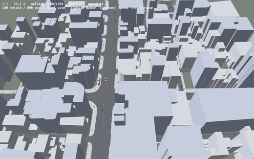
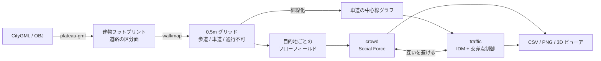
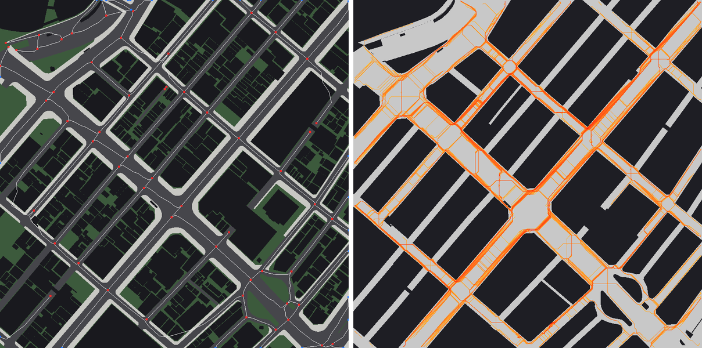
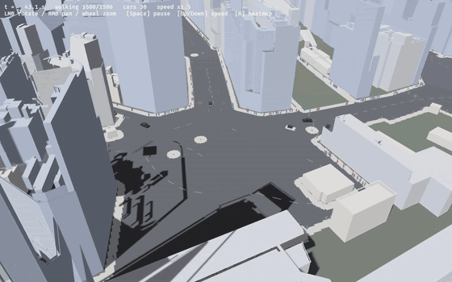
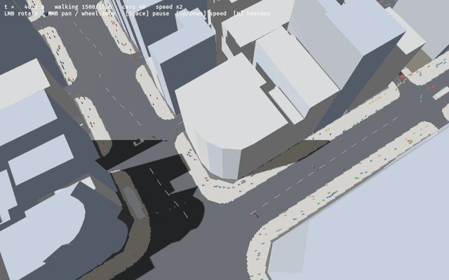
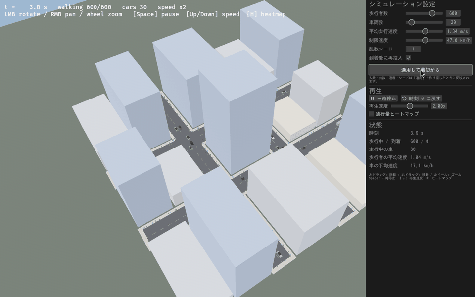

国土交通省の [Project PLATEAU](https://www.mlit.go.jp/plateau/) が公開している 3D 都市モデル（CityGML）を読み込んで、その上で歩行者と車を動かすシミュレーターを pure Rust で作りました。


*銀座 4 丁目交差点（和光・三越前）周辺 440m 四方。PLATEAU の建物 378 棟と LOD3 の道路の上を、歩行者 1500 人と車 40 台が動いています*

リポジトリ: https://github.com/T-T0821/citysim

できること:

- PLATEAU の CityGML（建物 `bldg` と道路 `tran`）、または PLATEAU SDK for Unity が書き出す OBJ を読む
- LOD3 道路の `tran:TrafficArea` から **歩道と車道を区別** し、歩行者は歩道を、車は車道を通る
- 歩行者は **Social Force Model**、車は **Intelligent Driver Model (IDM)** と交差点の通行権制御で動く
- 結果は軌跡 CSV（緯度経度つき）と通行量ヒートマップ PNG に出せるほか、**bevy の 3D ビューア** でリアルタイムに見られる
- ビューアの設定パネル（egui）で人数・台数・速度を変えて作り直せる。`--record` で動画用の連番 PNG も書き出せる

この記事では、PLATEAU のデータをどう扱ったか、どんなモデルで動かしているか、作っていてハマった点を紹介します。

## 動機

PLATEAU は日本の都市を建物 1 棟、道路 1 区画の単位で 3D モデル化したオープンデータです。見て楽しいだけでなく、建物の高さや道路の区分（車道部・歩道部など）といった **意味を持った属性** が入っているのが特徴です。

「この意味情報があれば、地図から手で歩行空間を作らなくても、データを読むだけで人流シミュレーションの舞台が作れるのでは？」というのが出発点でした。

もう 1 つの狙いは、Unity や Unreal を使わずに Rust だけで完結させることです。CityGML のパースから計算、描画まで 1 つの Cargo ワークスペースに収めると、ヘッドレスでのバッチ実行（パラメータを変えて何百回も回す）と、3D での目視確認を同じコードで行き来できます。

## 全体構成

```
crates/
  plateau-gml/  CityGML (bldg / tran) のストリーミングパーサ（quick-xml）と OBJ リーダ
  walkmap/      緯度経度→局所平面、歩行可能グリッド、フローフィールド、障害物距離場
  crowd/        Social Force Model による歩行者の計算
  traffic/      車道の中心線ネットワーク抽出と車両の計算（IDM・左側通行・交差点制御）
  cli/          ヘッドレス実行。軌跡 CSV と通行量ヒートマップ PNG を出力
  viewer/       bevy 0.16 + bevy_egui による 3D ビューア
```

外部依存は quick-xml・glam・bevy・bevy_egui くらいです。データの流れは次のとおりです。



銀座の 440m 四方（グリッド 881×880）で歩行者 1000 人と車 30 台を 300 秒動かすと、CLI での計算は約 3.7 秒（実時間の約 80 倍）でした。並列化はまだしていません。

## PLATEAU のデータを読む

### CityGML の最小限だけを読む

PLATEAU の CityGML は 3 次メッシュ（約 1km 四方）単位で配られ、1 ファイルが数十〜数百 MB あります。全部を DOM に載せる必要はないので、quick-xml でストリーミングしながら、シミュレーションに要る要素だけを拾っています。

拾っているのは次のものです。

| 地物 | 使う要素 | 用途 |
|---|---|---|
| `bldg:Building` | LOD0 のフットプリント（無ければ LOD1 立体の底面）、`bldg:measuredHeight` | 歩けない領域、3D 表示の押し出し |
| `tran:Road` | LOD1 の路面 | 歩ける領域 |
| `tran:TrafficArea` / `tran:AuxiliaryTrafficArea` | LOD2/LOD3 の面と `tran:function` | 歩道・車道・植栽の区別 |
| `gml:name` | 路線名 | 首都高の除外（後述） |

パーサは「いま開いている要素名のスタック」を持ち、`gml:posList` が閉じたときにスタックに `lod0` / `lod1` / `lod2` / `lod3` のどれが含まれるかで、どの LOD の面かを判定しています。

```rust
"posList" => {
    let ring = parse_pos_list(&text);
    if let Some(a) = p.area.as_mut() {
        // TrafficArea の中: LOD3 があれば LOD3、無ければ LOD2
        if stack.iter().any(|s| s.starts_with("lod3")) {
            a.3.push(ring);
        } else if stack.iter().any(|s| s.starts_with("lod2")) {
            a.2.push(ring);
        }
    } else if stack.iter().any(|s| s.starts_with("lod0")) {
        p.lod0.push(ring);
    } else if stack.iter().any(|s| s.starts_with("lod1")) {
        p.lod1.push(ring);
    }
}
```

### 座標は「緯度 経度 高さ」の順

PLATEAU の座標系は EPSG:6697（JGD2011 の緯度・経度 + 標高）で、`gml:posList` は **緯度・経度・高さ** の順に並びます。x, y の順だと思い込むと地図が 90 度回転して転置されるので注意が必要です。

シミュレーションは平面のメートル座標でやりたいので、範囲の南西端を原点にした正距円筒近似で局所座標に変換しています。数百 m の範囲なら誤差は無視できます。

### TrafficArea で歩道と車道を分ける

ここが PLATEAU を使う一番のうま味でした。LOD2/LOD3 の道路には `tran:TrafficArea` という区分面があり、`tran:function` のコードで用途が分かります。

| コード | 意味 | このシミュレーターでの扱い |
|---|---|---|
| 1000 | 車道部 | 車道 |
| 1010 | 車道交差部 | 車道 |
| 1020 | 島 | 車道（道路網の抽出で車道側に含める） |
| 2000 | 歩道部 | 歩道 |
| 3000 | 自転車歩行者道 | 歩道 |
| `AuxiliaryTrafficArea` | 植栽・分離帯など | 通行不可 |

これを 0.5m グリッドに塗り分けると、次の左図のような「歩行空間の地図」が自動でできます。明るい灰色が歩道部、暗い灰色が車道部、白線と赤い点は後で説明する車道の中心線と交差点です。右図は歩行者 1000 人を 300 秒流したときの通行量ヒートマップです。


*左: TrafficArea から作った歩道（明灰）・車道（暗灰）と抽出した道路網。右: 通行量ヒートマップ*

一方、LOD1 しかない道路は道路全体が 1 枚の面で、歩道と車道の区別がありません。その場合は「道路の端（建物や道路外）から 3m 以内を歩道、それより内側を車道」とみなす近似で代用しています。

### 範囲の切り出し

公式データはメッシュ単位で大きいので、`--crop 緯度,経度,半径m` で範囲を絞れるようにしました。さらにリポジトリに同梱する用に、`scripts/extract_gml.py` で銀座 4 丁目交差点の周辺だけを切り出した GML（3.3MB）を `testdata/ginza/` に置いています。clone すればすぐ動きます。

```sh
cargo run --release -p plateau-crowd-viewer -- \
  --gml testdata/ginza/53394601_bldg_6697_op.gml \
  --gml testdata/ginza/53394601_tran_6697_op.gml \
  --crop 35.67165,139.76500,220 --agents 1500 --vehicles 40
```

## 歩行者: フローフィールド + Social Force Model

### 経路はフローフィールドで決める

歩行者 1 人ずつに A* を回すと人数に比例して重くなるので、**目的地ごとに 1 枚の距離場（フローフィールド）** を作り、全員がそれを下っていく方式にしました。目的地は範囲の東西南北の縁の 4 つです。

距離場はグリッド上の 8 近傍 Dijkstra で作ります。セルのコストには次の 2 つを掛けています。

- 壁の近くはコストを上げる（壁にこすりつくような経路を避ける）
- **車道セルは 6 倍**（歩道を歩き、車道は最短で横断する）

この「車道 6 倍」が効いていて、歩行者は歩道を伝って歩き、交差点ではまっすぐ車道を渡るようになります。PLATEAU の道路データには横断歩道の面がないので、今は「どこでも渡れるが、渡るとコストが高い」という扱いです。

### 局所的な動きは Social Force Model

各歩行者に働く力は Helbing らの Social Force Model に沿っています。

$$
m\frac{d\mathbf{v}_i}{dt} = \underbrace{\frac{v_i^0\mathbf{e}_i - \mathbf{v}_i}{\tau}}_{\text{駆動力}}
+ \sum_{j\ne i} \underbrace{A\, e^{(r_{ij}-d_{ij})/B}\, w(\varphi_{ij})\, \mathbf{n}_{ij}}_{\text{他者からの反発}}
+ \underbrace{\mathbf{f}_{\text{wall}}}_{\text{壁}} + \underbrace{\mathbf{f}_{\text{car}}}_{\text{車}}
$$

- $\mathbf{e}_i$ はフローフィールドの勾配方向、$v_i^0$ は希望速度（平均 1.34 m/s にばらつき）
- $w(\varphi) = \lambda + (1-\lambda)\frac{1+\cos\varphi}{2}$ は視野の異方性で、前にいる人ほど強く意識します（$\lambda=0.35$）
- 体が重なったときは、重なり量に比例した押し返し（$k=120$）を足します
- 壁からの反発は、あらかじめ計算した **障害物距離場**（chamfer 距離）の勾配方向にかけます

```rust
// 前方の相手ほど強く意識する
let cos_phi = e.dot(-n);
let w = p.lambda + (1.0 - p.lambda) * 0.5 * (1.0 + cos_phi);
f += n * (p.a_agent * (overlap / p.b_agent).exp() * w);
if overlap > 0.0 {
    f += n * (p.k_body * overlap);
}
```

近傍探索は空間ハッシュ（セル 2.5m）なので、計算量はおおむね人数に比例します。車は歩行者から見ると「車体の形をしたカプセル」の動く障害物で、壁より強く、少し遠くから避けるようにしています。

## 車: 道路網の自動抽出と IDM

車を走らせるには道路の「線」（グラフ）が要りますが、PLATEAU の道路は面のデータです。そこで、車道セルの 2 値画像を **Zhang–Suen 法で細線化** し、その骨格をたどって交差点ノードと道路区間のグラフを作りました。範囲の縁で途切れる道路は出入口になります。


*渋谷スクランブル交差点（PLATEAU SDK for Unity の OBJ 書き出しを読み込み）。歩行者 1500 人・車 30 台*

### 縦方向は Intelligent Driver Model

車は中心線から 1.8m 左にずらしたレーンを走り（左側通行）、前の車・停止線・前方の歩行者のうち一番近いものに IDM で追従します。

$$
\frac{dv}{dt} = a\left[1 - \left(\frac{v}{v_0}\right)^4 - \left(\frac{s^*(v,\Delta v)}{s}\right)^2\right],\quad
s^* = s_0 + vT + \frac{v\,\Delta v}{2\sqrt{ab}}
$$

パラメータは $a=1.5\,\mathrm{m/s^2}$、$b=2.5\,\mathrm{m/s^2}$、$s_0=2\,\mathrm{m}$、$T=1.2\,\mathrm{s}$ です。停止線や歩行者は「速度 0 の先行車」として同じ式に入れられるので、止まる処理を個別に書かなくて済むのが IDM の便利なところです。

```rust
fn idm(v: f32, v0: f32, gap: f32, dv: f32, p: &Params) -> f32 {
    let free = 1.0 - (v / v0.max(0.1)).powi(4);
    if !gap.is_finite() {
        return p.a_max * free;
    }
    let s_star = p.s0 + (v * p.t_headway + v * dv / (2.0 * (p.a_max * p.b_comf).sqrt())).max(0.0);
    p.a_max * (free - (s_star / gap.max(0.1)).powi(2))
}
```

### 交差点は「動線」単位の通行権

信号機はまだ無いので、交差点は先着順の通行権で制御しています。単位は「進入レーン → 退出レーン」の **動線（Movement）** です。

- 交差点に入ろうとする車は、自分の動線を 2 次ベジェ曲線で近似し、通行中の他の動線と交わるかを調べる
- 交わらない動線（対向車線の直進同士など）は同時に通れる
- 待っている車がいれば、同じ動線が通り続けられるのは 6 秒まで（交代制）
- **出口側のレーンに入る余地がなければ交差点に入らない**（交差点の中で止まって塞がない）

## 3D ビューア

ビューアは bevy 0.16 で作っています。建物は LOD0 のフットプリントを計測高さまで押し出し、歩行者は目的地ごとに色分けした小さな柱、車は乗用車（4.5m）とトラック（7.5m、1 割）です。


*和光の角。歩行者は歩道部を歩き、車道は交差点付近で横断しています*

右側の設定パネルは bevy_egui です。歩行者数・車両数・平均歩行速度・制限速度・乱数シードを変えて「適用して最初から」で作り直せます。



記事の GIF は、ビューアの録画モードで撮っています。`--record <出力先> <秒数>` を付けると、描画速度に関係なく **1 フレーム = 一定のシミュレーション時間** で進めて連番 PNG を保存します。

```sh
cargo run --release -p plateau-crowd-viewer -- --gml testdata/sample.gml --agents 700 --vehicles 30 \
    --record rec 20 --speed 1.5 --orbit 0.04 --warmup 30
ffmpeg -framerate 30 -i rec/frame_%05d.png -c:v libx264 -pix_fmt yuv420p sim.mp4
```

## ハマった点

### 1. 公式配布サイトに届かない環境があった

開発の一部を、外部ネットワークが制限された環境で進めていて、G 空間情報センターや PLATEAU の配信サーバーに直接アクセスできませんでした。最初は GitHub 上に公開されていた渋谷 4 メッシュ分の OBJ（PLATEAU SDK for Unity の書き出し）を読む対応を入れてしのぎ、その後、PLATEAU SDK for Unreal の GIS サンプルリポジトリが Git LFS で同梱していた東京都 23 区の CityGML を見つけて、銀座のデータを使えるようになりました。

OBJ はグループ名（`g bldg_…` / `g tran_…`）で建物と道路を分けられますが、座標は局所座標で、**x が西向き・z が北向き・y が上向き**、原点は取り込み範囲の基準点です。原点の緯度経度を `--obj-origin` で渡す必要があり、ここでも一度東西が反転しました。

### 2. 首都高が地上の道路に重なる

銀座の周辺には首都高（高架や掘割）が通っています。2D に投影すると、首都高の路面が地上の道路や建物の上に重なり、「建物の上を車が走る」「歩道の上に車道ができる」状態になりました。PLATEAU の道路には立体交差の上下関係を簡単に判定できる属性がなかったので、**路線名（`gml:name`）に「高速」を含む道路を除外** するという割り切りで解決しています。

### 3. LOD3 の道路は三角形メッシュ

LOD3 の区分面には、平面ポリゴンではなく細かい三角形メッシュで入っているものがあります。そのままでも塗りつぶしはできますが、ファイルが大きくなるので、切り出しスクリプトでは shapely があれば三角形を結合して平面ポリゴンに置き換えています。

### 4. 細線化すると広い交差点がバラバラになる

渋谷のスクランブル交差点や銀座 4 丁目のような広い交差点を細線化すると、骨格が何本にも割れて、1 つの交差点が近接した複数のノードになります。そのままだと車が交差点の中で何度も通行権を取り直してしまうので、**14m 未満の区間でつながったノードを 1 つにまとめる** 処理と、短いヒゲ（行き止まりの枝）を刈る処理を入れました。

### 5. 交差点のデッドロック

先着順の通行権は、複雑な交差点では簡単にデッドロックします。互いの出口を塞ぎ合う、交差点の中で止まった車が別の動線を塞ぐ、などです。最終的に次の 3 つで落ち着きました。

1. 出口側のレーンに入る余地がなければ交差点に入らない
2. 待ち車がいれば 6 秒で通行権を交代する
3. それでも 15 秒待たされたら、通行権を待たずに進む（最後の逃げ道）

### 6. 歩行者と車のにらみ合い

車は前に歩行者がいると止まり、歩行者は車を避けようとします。車道の真ん中で両者が譲り合って動かなくなることがありました。現実の車のように、**5 秒以上止まったら徐行（1.2 m/s）で少しずつ進む** ようにしたところ、歩行者が避けて解消するようになりました。

### 7. GPU の無い環境で bevy の画面を撮る

スクリーンショットや動画は GPU の無いサーバーで撮っています。Xvfb の仮想ディスプレイと、mesa のソフトウェア Vulkan（lavapipe）で bevy を動かしました。`libxkbcommon-x11-0` が入っていないと winit が起動時に panic するので注意が必要です。ソフトウェア描画は 1280×800 で 1 フレーム約 0.5 秒かかるため、録画モードではフレームごとに決まった時間だけシミュレーションを進め、描画の遅さが映像に出ないようにしています。

## 今後

- **信号機と横断歩道**: PLATEAU の道路に横断歩道の面が無いので、別データか手動定義が必要です。並行して開発しています。
- **シナリオ定義**: 駅の出口などの出発地・目的地、発生レート、時間帯を TOML で書けるようにする（こちらも開発中）
- **評価指標**: 密度（人/m²）、流量、サービス水準（LOS）、避難完了時間
- **高速化**: rayon による並列化で数万人規模に
- **表示の拡張**: LOD2 の屋根形状やテクスチャ、地形、wasm + WebGPU でブラウザ表示

## まとめ

PLATEAU の LOD3 道路に入っている「車道部・歩道部」の区分のおかげで、地図を手で整備しなくても、データを読むだけで歩行者と車が住み分ける街ができました。一方で、首都高のような立体構造や、横断歩道・信号のように道路データに無いものは、割り切りや別データが必要です。

Rust だけで、パースから計算、3D 表示、録画までを 1 つのワークスペースに収められたのも良かった点です。興味があれば、ぜひ手元の街のデータで動かしてみてください。

---

出典: 国土交通省 Project PLATEAU 3D 都市モデル（東京都 23 区 2023 年度、渋谷区）を加工して作成（[PLATEAU サイトポリシー](https://www.mlit.go.jp/plateau/site-policy/)、CC BY 4.0 互換）。
